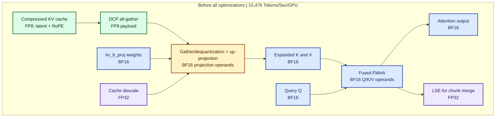
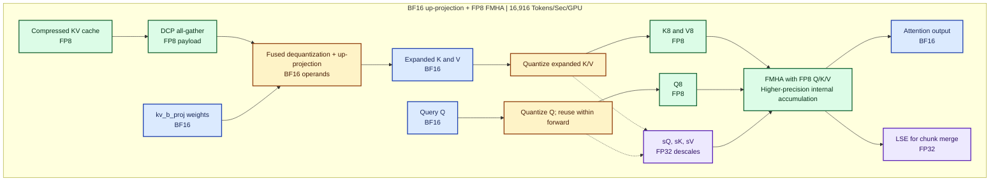
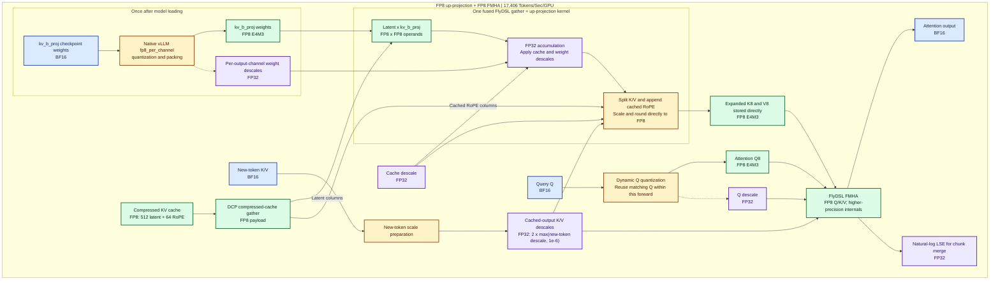

# FP8 FMHA: BF16 projection weights and FP8 attention tensors

[中文](fp8-fmha-dataflow_zh.md) | [Current audit](kimi-prefill-overhead-audit.md) | [ATOM opportunities](atom-vllm-opportunities-2026-10-28.md)

This describes the large cached-prefix path tested at serving checkout e4cf47a7650321e4bd40c83746088a2679ec0509. New-token and small cached-context attention remain BF16. The full-run result is pending.

**The key distinction:** kv_b_proj reconstructs K/V before FMHA starts. Its BF16 weights are not inputs to FMHA. Compressed KV cache, projection weights, and expanded attention K/V are three different objects.

| Object | Current dtype | Shape per TP rank |
|---|---|---|
| Compressed cache | FP8 E4M3 | 512 latent + 64 RoPE values per token |
| kv_b_proj weights | BF16 | [3072, 512] |
| Expanded K | BF16, then FP8 | [Tkv, 12, 192] |
| Expanded V | BF16, then FP8 | [Tkv, 12, 128] |
| Query Q | BF16, then FP8 | [Tq, 12, 192] |
| Q/K/V descales | FP32 | One scalar per tensor for the current quantization call |
| Attention output / LSE | BF16 / FP32 | [Tq, 12, 128] / [12, Tq] |

Tkv and Tq refer to packed token counts in the current chunk/query call. The twelve heads are this TP8 configuration's local prefill heads.

**Colors:** green = FP8; blue = BF16; amber = format conversion; purple = FP32 scales/LSE.

## Before all optimizations

This is the MLA prefill baseline before the FP8 attention changes discussed here.
The compressed KV cache was already FP8; projection weights, expanded K/V and
FMHA operands were BF16. The diagram shows logical dataflow; gather,
dequantization and projection may share a fused kernel.

Exact full-run throughput: **15,476.46881 total input + output tokens/s/GPU**,
[baseline run 39239112271](https://github.com/ajith-sirra-amd/InferenceMAX_Rocm_Team/actions/runs/39239112271).

## BF16 up-projection with FP8 FMHA — existing chart

Exact full-run throughput: **16,915.72154 total input + output tokens/s/GPU**,
[run 40646139769](https://github.com/ajith-sirra-amd/InferenceMAX_Rocm_Team/actions/runs/40646139769).
The chart below retains the original BF16-projection dataflow.

## 1. Reconstruct the expanded K/V

Subscripts 16 and 8 mean BF16 and E4M3 FP8. Let C16 be the latent reconstructed from the compressed cache and its cache descale. The logical projection is:

$$
Z_{16} = \mathrm{BF16}(C_{16} W_{\mathrm{kv},16}^{T})
$$

C16 has shape [Tkv,512]; the weight has shape [3072,512], where 3072 = 12 x (128+128). Reshape Z16 into [Tkv,12,256], then split it into 128-wide non-RoPE K and 128-wide V. Append the 64 cached RoPE columns to each K head:

$$
K_{16}=\mathrm{concat}(K_{\mathrm{NoPE},16},K_{\mathrm{RoPE},16}),\qquad V_{16}=V_{\mathrm{projected},16}.
$$

The implementation fuses cache row gathering, dequantization, projection and assembly; these equations do not imply separate materialized buffers for every step.

## 2. Quantize the expanded operands

For each X in {Q,K,V}, independently:

$$
s_X =
\begin{cases}
\max|X_{16}|/448 & \max|X_{16}|>0 \\
10^{-6} & \text{otherwise}
\end{cases}
$$

$$
X_8=\mathrm{E4M3}\left(\mathrm{clip}(X_{16}/s_X,-448,448)\right),\qquad X_{16}\approx s_X X_8.
$$

448 is the largest finite E4M3FN value. The implementation uses an FP32 reciprocal and rounding. These are expanded-tensor descales, not the compressed-cache descale. Q8 and its scale are reused only within the same immutable forward; each cached K/V chunk is prepared separately.

## 3. FP8 FMHA

For one head, the logical equations are:

$$
S\approx \alpha s_Q s_K Q_8K_8^T+M,\qquad P=\mathrm{softmax}(S),\qquad
O_{16}\approx\mathrm{BF16}(s_VPV_8).
$$

Alpha is the model's configured softmax scale, M is the mask, and P contains attention weights. These equations describe the operation, not every instruction or intermediate rounding. FlashAttention computes tiled online softmax instead of materializing full S/P matrices. The inspected AITER FP8 implementation also casts its probability tile for FP8 matrix multiplication; FP8 operands do not mean all accumulators and softmax intermediates use FP8. The API returns BF16 output and FP32 natural-log LSE, which native vLLM uses to merge chunks.

## The removable cost

Current: reconstruct expanded BF16 K/V -> write it -> read it for quantization -> write FP8 K/V -> FMHA.

Target: reconstruct -> scale/round in the reconstruction epilogue -> write FP8 K/V -> FMHA.

BF16 projection weights do not mathematically require BF16 output storage. Retaining BF16 weights and adding an FP8 epilogue is a possible kernel design, but it is not implemented in this candidate. Valid output scales still need to be obtained.

Expanded K/V occupy 7680 bytes/token/rank in BF16 and 3840 in FP8 for these shapes. These are logical storage sizes, not measured HBM traffic or a promised cache-capacity saving.

## How ATOM implements direct FP8 output

Reviewed ATOM 661ef7661eef0d804d2b52d81ed41d80aeaf9fdb and AITER bbef5a6f2d3733b293c80d2cee6a8d464e88bc01. The latter is a source-review revision, not proof of the AITER version installed in the current image.

1. The repository ATOM recipe requests global ptpc_fp8 online weight quantization. Its layers.*.self_attn.kv_b_proj exclusion is for the unprefixed draft tree; the target uses model.layers.* and is not excluded by that pattern.
2. ATOM's optional FP8 prefill path quantizes new-token Q/K/V once. It supplies cached-output descales equal to max(new-token descale, 1e-6) x 2.
3. DCP communicates compressed FP8 cache rows. The gather/reconstruction kernel performs row mapping, projection, split and RoPE assembly.
4. When the installed FlyDSL API and layouts support it, ATOM passes k_out_scale and v_out_scale and writes FP8 directly into views of its existing BF16 workspaces. It returns K8,V8,sK,sV to FMHA, bypassing a separate cached-K/V quantizer.
5. This FlyDSL path requires compatible FP8 cache and FP8 projection weights/scales. BF16 weights take ATOM's Triton fallback. Our pinned native vLLM fused route instead requires BF16 contiguous projection weights; merely changing their dtype would select its fallback.
6. Direct output computes no cached-chunk amax. The two-times new-token scale is a scale policy, not a bound proving that every cached value fits. Validate cached outliers, zero/small new-token ranges, RoPE columns and complete attention output before serving.
7. The inspected ATOM recipe does not enable ATOM_USE_FLYDSL_FP8_PREFILL_ATTN, whose source default is 0. The direct-FP8 capability must not be attributed to a historical run without runtime evidence.

The AITER isolated timing helper first derives scales from the same reconstructed test input and reuses them for the fused case. That demonstrates supplied-scale kernel behavior; it does not validate ATOM's two-times-new-token scale policy on real cached prefixes.

## Source anchors

- [Current quantizer](../../upstream/InferenceX/benchmarks/single_node/agentic/atom_attention/inferencex_atom_attention/quantize.py)
- [Current FMHA adapter](../../upstream/InferenceX/benchmarks/single_node/agentic/atom_attention/inferencex_atom_attention/backend.py)
- [ATOM direct gather and BF16 fallback](https://github.com/ROCm/ATOM/blob/661ef7661eef0d804d2b52d81ed41d80aeaf9fdb/atom/model_ops/attention_mla.py#L1671)
- [ATOM scale source](https://github.com/ROCm/ATOM/blob/661ef7661eef0d804d2b52d81ed41d80aeaf9fdb/atom/model_ops/triton_fused_qkv_quant.py#L142)
- [AITER direct-output contract](https://github.com/ROCm/aiter/blob/bbef5a6f2d3733b293c80d2cee6a8d464e88bc01/aiter/ops/flydsl/gather_kv_b_proj.py#L415)
- [AITER supplied-scale timing helper](https://github.com/ROCm/aiter/blob/bbef5a6f2d3733b293c80d2cee6a8d464e88bc01/op_tests/test_flydsl_gather_kv_b_proj.py#L849)

## FP8 up-projection with direct FP8 K/V — implemented path

This chart records the completed cached-context plugin path at source
`14250d6c6c17cd54fb7cd480c74c5c4eb5da2e78`.
It uses native online-quantized FP8 `kv_b_proj` weights and AITER's
`gather_kv_b_proj_flydsl` to write FP8 K/V directly for FP8 FMHA.

**Colors:** green = FP8; blue = BF16; amber = conversion; purple = FP32
scales, accumulation or LSE. The nested kernel box contains internal steps,
not separate intermediate buffers.

Exact full-run throughput: **17,406.08912 total input + output tokens/s/GPU**,
[run 40695099743](https://github.com/ajith-sirra-amd/InferenceMAX_Rocm_Team/actions/runs/40695099743).

The projection uses FP8 multiplication operands and FP32 accumulation. Its
epilogue rescales, assembles RoPE and rounds directly into FP8 K/V storage.
There is no expanded BF16 K/V buffer between cached up-projection and FMHA.
FP8 storage does not mean every accumulator or scale operation runs in FP8.

The Q and new-token scale boxes show logical dependencies. The implementation
jointly quantizes new-token Q/K/V during preparation. Cached-query slices reuse
Q8 only for an exact pointer/shape/stride match within the same forward;
other slices retain their own quantization. Cached K/V output descales use
2x headroom from the new-token ranges, without a cached-chunk amax pass.

The throughput labels are rounded to the nearest whole token:
**15,476 → 16,916 → 17,406 tokens/s/GPU**.
They describe complete benchmark configurations, including other tuning;
the differences are not isolated FMHA or up-projection kernel gains.

The separate [causal FP8 experiment](causal-fp8-attention.md) reuses prepared
new-token Q/K/V with their original descales. Its throughput is still pending;
the 17,406 label belongs to the completed run with BF16 new-token causal attention.
The [native projection audit](native-fp8-up-projection-audit.md) records
implementation, accuracy evidence and the remaining numerical limitation.
