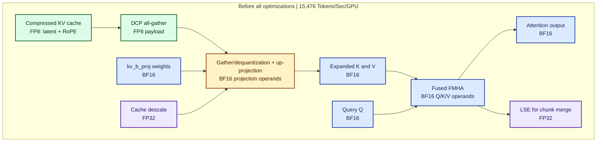
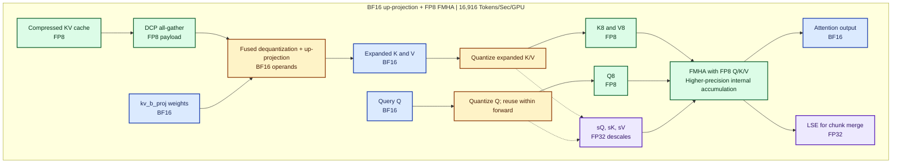
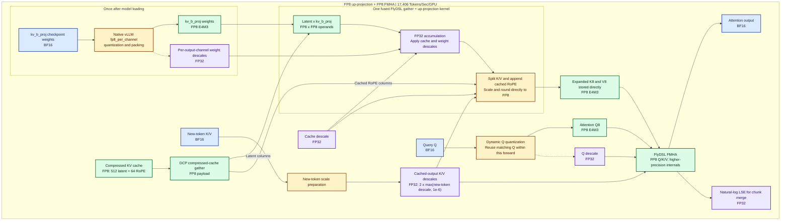

# FP8 FMHA：BF16 投影权重与 FP8 注意力张量

[English](fp8-fmha-dataflow.md) | [当前审计](kimi-prefill-overhead-audit_zh.md) | [ATOM 优化机会](atom-vllm-opportunities-2026-10-28_zh.md)

本文对应 serving checkout e4cf47a7650321e4bd40c83746088a2679ec0509 的大型缓存前缀路径。新 token 和小缓存块仍使用 BF16 注意力。完整运行结果尚未产生。

**关键区别：kv_b_proj 在 FMHA 之前重建 K/V。FMHA 不读取这些 BF16 投影权重。** 压缩 KV 缓存、投影权重和展开后的注意力 K/V 是三个不同对象。

| 对象 | 当前类型 | 每个 TP rank 的形状 |
|---|---|---|
| 压缩 KV 缓存 | FP8 E4M3 | 每 token：512 个 latent 值 + 64 个 RoPE 值 |
| kv_b_proj 权重 | BF16 | [3072,512] |
| 展开 K | BF16，再转换成 FP8 | [Tkv,12,192] |
| 展开 V | BF16，再转换成 FP8 | [Tkv,12,128] |
| 查询 Q | BF16，再转换成 FP8 | [Tq,12,192] |
| Q/K/V descale | FP32 | 当前量化调用中每个张量各一个标量 |
| 注意力输出 / LSE | BF16 / FP32 | [Tq,12,128] / [12,Tq] |

Tkv、Tq 是本次缓存块或查询调用打包后的 token 数。12 是此 TP8 配置每个 rank 的本地 prefill head 数。

**颜色：** 绿色 = FP8；蓝色 = BF16；黄色 = 类型转换；紫色 = FP32 scale/LSE。

## 所有这些优化之前

这是本文 FP8 注意力改动之前的 MLA prefill 基线。
压缩 KV 缓存已经是 FP8；投影权重、展开 K/V 及 FMHA 输入为 BF16。
图示为逻辑数据流；gather、反量化与投影可以在同一融合内核中完成。

完整运行精确吞吐量：**15,476.46881 输入加输出 tokens/s/GPU**，
[基线运行 39239112271](https://github.com/ajith-sirra-amd/InferenceMAX_Rocm_Team/actions/runs/39239112271)。

## BF16 上投影与 FP8 FMHA — 保留的原图

完整运行精确吞吐量：**16,915.72154 输入加输出 tokens/s/GPU**，
[运行 40646139769](https://github.com/ajith-sirra-amd/InferenceMAX_Rocm_Team/actions/runs/40646139769)。
下图保留原来的 BF16 投影数据流。

## 1. 用 BF16 权重重建 K/V

下标 16、8 分别表示 BF16 和 E4M3 FP8。C16 表示根据压缩缓存及其 descale 恢复的 latent。逻辑投影为：

$$
Z_{16}=\mathrm{BF16}(C_{16}W_{\mathrm{kv},16}^{T}).
$$

C16 为 [Tkv,512]，权重为 [3072,512]，其中 3072=12 x (128+128)。Z16 重排为 [Tkv,12,256]，拆成 128 维的非 RoPE K 和 128 维 V。再向每个 K head 拼接缓存中 64 维 RoPE：

$$
K_{16}=\mathrm{concat}(K_{\mathrm{NoPE},16},K_{\mathrm{RoPE},16}),\qquad V_{16}=V_{\mathrm{projected},16}.
$$

实际内核融合了缓存行读取、反量化、投影及拼接；这些逻辑公式不表示每一步都有独立中间缓冲。

## 2. 将展开张量量化成 FP8

对 X 属于 {Q,K,V} 分别计算：

$$
s_X =
\begin{cases}
\max|X_{16}|/448 & \max|X_{16}|>0 \\
10^{-6} & \text{otherwise}
\end{cases}
$$

$$
X_8=\mathrm{E4M3}\left(\mathrm{clip}(X_{16}/s_X,-448,448)\right),\qquad X_{16}\approx s_XX_8.
$$

448 是 E4M3FN 的最大有限值。实现使用 FP32 倒数及舍入。这里的 descale 属于展开张量，不是压缩 KV 缓存的 descale。Q8 及其 scale 只在同一不可变 forward 内复用，每个缓存 K/V 块单独准备。

## 3. FP8 FMHA 的逻辑数学

对一个 head：

$$
S\approx\alpha s_Qs_KQ_8K_8^T+M,\qquad P=\mathrm{softmax}(S),\qquad O_{16}\approx\mathrm{BF16}(s_VPV_8).
$$

Alpha 是模型配置的 softmax scale；M 是 mask；P 是注意力权重。以上是逻辑运算，不包含所有指令和中间舍入。FlashAttention 使用分块 online softmax，不物化完整 S/P 矩阵。审阅的 AITER FP8 实现也会将概率 tile 转换用于 FP8 矩阵乘法；FP8 输入不代表累加器和 softmax 中间结果全部采用 FP8。API 返回 BF16 输出和自然对数形式的 FP32 LSE，vLLM 使用它们合并分块结果。

## 要移除的额外开销

当前：重建 BF16 K/V -> 写入 -> 量化再次读取 -> 写 FP8 K/V -> FMHA。

目标：重建 -> 在输出阶段缩放并舍入 -> 直接写 FP8 K/V -> FMHA。

BF16 投影权重在数学上不强制要求 BF16 输出存储。保留 BF16 权重并添加 FP8 输出阶段是可行的内核设计方向，但当前候选没有实现。仍需获得正确的输出 scale。

上述形状中，展开 K/V 的逻辑存储为每 token、每 rank 7680 字节 BF16，或 3840 字节 FP8。这不是实测 HBM 流量，也不是 KV 缓存容量收益承诺。

## ATOM 如何直接输出 FP8

审阅 ATOM 661ef7661eef0d804d2b52d81ed41d80aeaf9fdb，以及 AITER bbef5a6f2d3733b293c80d2cee6a8d464e88bc01。后者只是源码审阅版本，不能证明当前镜像安装了这个 AITER 版本。

1. 仓库的 ATOM 启动脚本请求全局 ptpc_fp8 在线权重量化。layers.*.self_attn.kv_b_proj 的排除模式匹配没有前缀的 draft 树；主模型使用 model.layers.*，不被此模式排除。
2. 可选 FP8 prefill 路径先量化新 token 的 Q/K/V。缓存输出 descale 使用 max(新 token 的 descale, 1e-6) x 2。
3. DCP 传输压缩 FP8 缓存行；融合 gather/reconstruction 完成行重排、投影、拆分及 RoPE 拼接。
4. 当已安装 FlyDSL API 和布局支持时，ATOM 传入 k_out_scale、v_out_scale，在现有 BF16 workspace 的 FP8 view 中直接写 FP8，返回 K8,V8,sK,sV 给 FMHA，跳过单独的缓存 K/V 量化。
5. 此 FlyDSL 路径要求兼容的 FP8 缓存及 FP8 投影权重/scales。BF16 权重走 ATOM 的 Triton fallback。当前固定版本 vLLM 的原生融合路径则要求连续 BF16 投影权重，仅修改权重类型会使它选择 fallback。
6. 直接输出不计算缓存块的 amax。“新 token scale 乘二”是一项 scale 策略，不是所有缓存值都不会溢出的证明。投入 serving 前应检查缓存异常值、全零或小范围新 token、RoPE 列及完整注意力输出。
7. 审阅的 ATOM 脚本没有启用 ATOM_USE_FLYDSL_FP8_PREFILL_ATTN，其默认值为 0。不能在没有运行证据时，把该能力归因于历史 ATOM 性能结果。

AITER 的独立计时 helper 先从同一份重建测试输入计算 scale，再复用 scale 测融合路径。这证明已提供 scale 时的内核行为，不证明 ATOM 在真实缓存前缀上采用的新 token scale 乘二策略正确。

完整源码链接见 [English 文档的 Source anchors](fp8-fmha-dataflow.md#source-anchors)。

## FP8 上投影并直接输出 FP8 K/V — 已实现路径

此图对应已完成的缓存上下文插件路径，源码为
`14250d6c6c17cd54fb7cd480c74c5c4eb5da2e78`。
它使用原生在线量化的 FP8 `kv_b_proj` 权重和 AITER
`gather_kv_b_proj_flydsl`，直接写出 FP8 K/V 供 FP8 FMHA 使用。

**颜色：** 绿色 = FP8；蓝色 = BF16；黄色 = 类型转换；紫色 = FP32 scale、
累加器或 LSE。嵌套 kernel 框表示内核内部步骤，不代表独立中间缓冲。

完整运行精确吞吐量：**17,406.08912 输入加输出 tokens/s/GPU**，
[运行 40695099743](https://github.com/ajith-sirra-amd/InferenceMAX_Rocm_Team/actions/runs/40695099743)。

投影使用 FP8 乘法输入和 FP32 累加。输出阶段完成缩放、RoPE 拼接，
并直接舍入写入 FP8 K/V。缓存上投影与 FMHA 之间不再物化展开的 BF16 K/V 缓冲。
FP8 存储不表示所有累加及 scale 运算都使用 FP8。

Q 与新 token scale 方框表示逻辑依赖；实现中在准备阶段联合量化新 token 的 Q/K/V。
缓存查询切片仅在同一 forward 内指针、形状和 stride 完全匹配时复用 Q8，
其他切片保留各自的量化范围。缓存 K/V 输出 descale 使用新 token 范围的两倍余量，
不额外计算缓存块 amax。

图中吞吐量按最接近的整数四舍五入：
**15,476 → 16,916 → 17,406 tokens/s/GPU**。
这些数值代表包含其他调优的完整 benchmark 配置，差值不能归因于单个 FMHA 或上投影 kernel。

独立的[因果 FP8 实验](causal-fp8-attention_zh.md)复用已准备的新 token Q/K/V
及原始 descale，吞吐量仍待测量；17,406 对应已完成且新 token 因果注意力仍为 BF16 的运行。
[原生投影审计](native-fp8-up-projection-audit_zh.md)记录实现、准确率证据及剩余数值问题。
